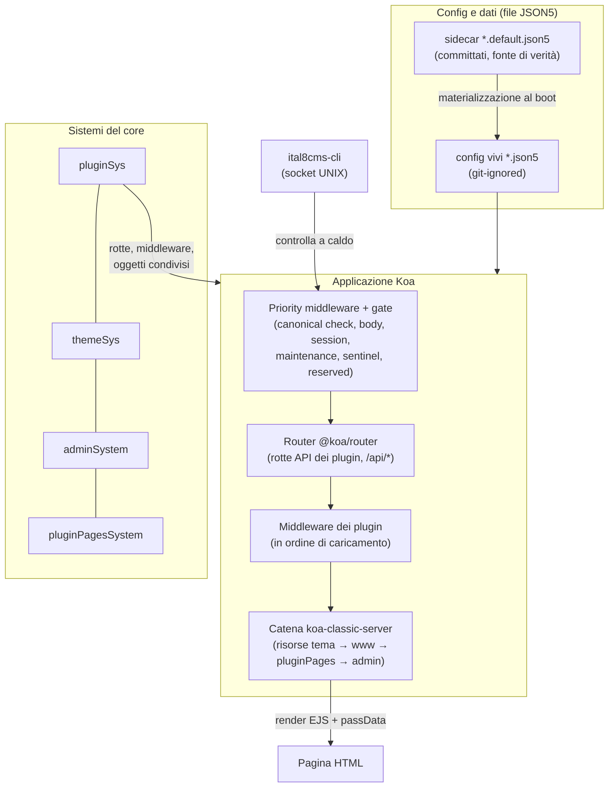
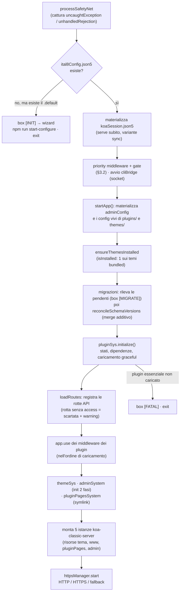
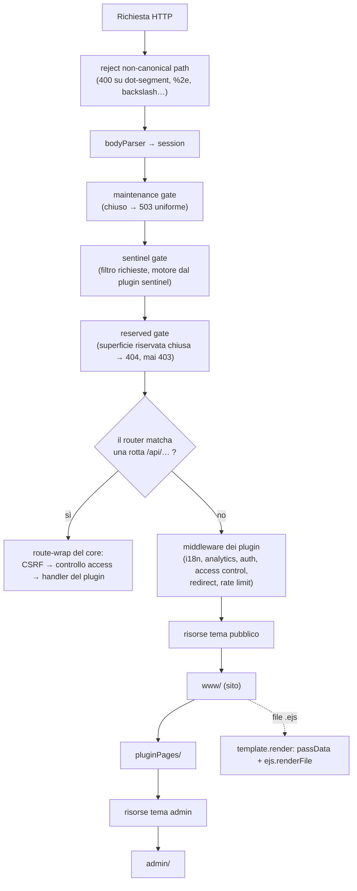

<!-- ital8doc v1-1 · tipo: guide · lang: it · rev: 1 · ref -->
> 🌐 Italian reference edition (always up to date). English `architettura.md` is a stub until release.
# Architettura — ital8cms

Questo documento è la mappa architetturale di ital8cms: descrive **com'è fatto il sistema oggi** e rimanda ai deep-dive per i dettagli. Il **perché** delle scelte, le alternative scartate e le critiche vivono nel documento gemello: [`storia-e-albero-delle-scelte.it.md`](./storia-e-albero-delle-scelte.it.md).

**Indice:** [0. Convenzione di scrittura](#0-convenzione-di-scrittura) · [1. Il sistema in una pagina](#1-il-sistema-in-una-pagina) · [2. Fondamenta runtime](#2-fondamenta-runtime) · [3. Ciclo di vita dell'applicazione](#3-ciclo-di-vita-dellapplicazione) · [4. Configurazione e dati](#4-configurazione-e-dati) · [5. Il sistema plugin](#5-il-sistema-plugin) · [6. Il sistema temi](#6-il-sistema-temi) · [7. Il sistema admin](#7-il-sistema-admin) · [8. Sicurezza](#8-sicurezza) · [9. Piano operativo](#9-piano-operativo) · [10. Qualità](#10-qualità) · [11. Mappa della documentazione](#11-mappa-della-documentazione)

---

## 0. Convenzione di scrittura

> **Questo documento e il suo gemello seguono un profilo di scrittura ispirato ad ASD-STE100** (Simplified Technical English), lo standard dei manuali aerospaziali. Lo standard vero vale solo per l'inglese: qui se ne adottano i **principi**, non la conformità.
>
> Le regole:
> 1. Frasi brevi: massimo ~20-25 parole. Un'idea per frase.
> 2. Voce attiva con soggetto esplicito: "il core carica i plugin", non "i plugin vengono caricati".
> 3. Un termine, un concetto: lo stesso oggetto ha sempre lo stesso nome (vedi il glossario in §1). Niente sinonimi decorativi.
> 4. Elenchi puntati al posto delle enumerazioni in prosa. Paragrafi di massimo ~6 frasi.
> 5. **Clausola di flessibilità:** dove un'argomentazione richiede sfumature (trade-off, critiche, ipotesi), la prosa si scioglie. La deroga è ammessa; l'abuso no.
>
> **Ambito:** la convenzione vale per questo documento e per [`storia-e-albero-delle-scelte.it.md`](./storia-e-albero-delle-scelte.it.md). Non è (ancora) parte dello standard [ital8doc](./ITAL8DOC-latest.md): promuoverla sarà un'eventuale decisione futura.

---

## 1. Il sistema in una pagina

**ital8cms è un CMS modulare per sviluppatori, costruito su Node.js e Koa.** Non ha editor visuali. Tutta la personalizzazione passa da codice, template EJS e file di configurazione JSON5.

Tre principi reggono l'intero sistema:

1. **Zero database.** Il core archivia dati strutturati in file JSON5 e contenuti in file sul disco. Un DBMS (SQLite) è un plugin opzionale, non un requisito.
2. **Quasi tutto è un plugin.** Autenticazione, controllo accessi, CSRF, rate limiting, analytics, persino gran parte del pannello admin: sono plugin con un contratto uniforme. Il core carica, ordina e sorveglia.
3. **Il filesystem è il sito.** `koa-classic-server` serve le directory come un web server classico: un file `.ejs` in `www/` è una pagina, senza registrare rotte.



### Glossario (un termine, un concetto)

| Termine | Significato |
|---|---|
| **plugin** | modulo in `plugins/<nome>/` con `main.js` + descrittore; estende il sistema |
| **tema** | pacchetto in `themes/<nome>/` di partial EJS, template e risorse statiche |
| **descrittore** | il `pluginConfig.json5` / `themeConfig.json5` di un pacchetto |
| **sidecar `.default`** | il file `x.default.json5` committato; fonte di verità del config `x.json5` |
| **config vivo** | il file `x.json5` modificabile, git-ignored, rigenerabile dal suo `.default` |
| **materializzazione** | la copia atomica `.default` → vivo eseguita al boot quando il vivo manca |
| **gate** | middleware pre-router che chiude o filtra una superficie (maintenance, reserved, sentinel) |
| **superficie riservata** | l'insieme dei path che richiedono autenticazione; derivata, non elencata a mano |
| **zona** | partizione dello spazio URL governata da un prefisso configurabile (admin, api, pluginPages, …) |
| **boot** | la sequenza di avvio da `index.js` fino ai server HTTP/HTTPS attivi |

**Numeri attuali** (v3.38.0, 2026-11): 26 plugin bundled, 7 temi, 179 suite Jest / ~5.400 test, più test E2E Playwright.

> **Perché così** — Il progetto rifiuta l'approccio "zero-knowledge" dei CMS mainstream e punta a sviluppatori che vogliono il controllo completo dello stack. La genesi di questa scelta, con le alternative considerate (WordPress, Strapi, generatori statici), è nel nodo **[D0](./storia-e-albero-delle-scelte.it.md#d0)** del documento delle scelte.

---

## 2. Fondamenta runtime

Lo stack è deliberatamente corto. Nessun transpiler, nessun bundler, nessun build step: il codice che scrivi è il codice che gira.

| Componente | Versione | Ruolo |
|---|---|---|
| **Node.js** | ≥ 22.13 | runtime; moduli **CommonJS** |
| **Koa** | 3.x | framework HTTP; middleware a cascata (modello "a cipolla") |
| **koa-classic-server** | 5.x | file server "stile Apache" con render EJS integrato |
| **@koa/router** | 15.x | rotte API dei plugin |
| **EJS** | 6.x | motore dei template (pagine, temi, admin) |
| **JSON5** | 2.x | formato di tutti i file di configurazione |
| **koa-session** + **bcryptjs** | — | sessioni e hash delle password |
| **Bootstrap** | 5.3 | UI di default (temi e pannello admin) |

Tre proprietà di questo strato meritano attenzione:

- **CommonJS, niente top-level await.** Per questo l'intero boot asincrono vive nella funzione `startApp()` di `index.js`, invocata in fondo al file.
- **`koa-classic-server` è una dipendenza mantenuta dal team** (stesso maintainer). Regola vincolante: un bug nel modulo si corregge **nel modulo**, mai con un workaround dentro ital8cms. La regola è formalizzata in [`CLAUDE.md`](../CLAUDE.md) → *Dipendenze Mantenute dal Team*.
- **Il render EJS è un hook del file server.** `koa-classic-server` accetta `template.render`: quando il path risolve su un file `.ejs`, chiama il callback di ital8cms, che costruisce `passData` e invoca `ejs.renderFile`. Il CMS non registra una rotta per pagina: registra un render per estensione.

> **Perché così** — Koa invece di Express per i middleware async nativi; un file server "classico" invece di rotte esplicite per avere il modello "filesystem = sito"; EJS per restare a HTML + JavaScript puro. Alternative e trade-off nei nodi **[D1](./storia-e-albero-delle-scelte.it.md#d1), [D1a](./storia-e-albero-delle-scelte.it.md#d1a), [D1b](./storia-e-albero-delle-scelte.it.md#d1b)** del documento delle scelte.

---

## 3. Ciclo di vita dell'applicazione

### 3.1 Boot

Il boot parte in `index.js` e finisce con i server in ascolto. La sequenza è progettata per **fallire presto e chiaramente** (box diagnostici `[INIT]`, `[CONFIG]`, `[FATAL]`) e per **degradare con grazia** su tutto ciò che non è essenziale.



Punti fermi della sequenza:

- **Il ciclo di vita dei config gira prima dei sistemi che li leggono** (§4.2): materializzazione, migrazioni, riconciliazione.
- **Il boot completa sempre**, salvo tre casi fatali: config globale assente o rotto, `.default` mancante, plugin di `essentialPlugins` non caricato.
- **Ogni anomalia non fatale produce un box in console** (`[PLUGINS]`, `[SCHEMA]`, `[MIGRATE]`, `[WEIGHT]`, `[STORAGE]`, `[SENTINEL]`): il problema è detto a voce alta, il sito resta su.

### 3.2 Vita di una richiesta

Koa esegue i middleware nell'ordine di montaggio. L'ordine è fisso per i priority middleware e derivato dall'ordine di caricamento per i middleware dei plugin (§5.3).



Tre proprietà del percorso:

- **I gate stanno prima del router**: intercettano anche le rotte API, e il loro ordine è parte del design. Il maintenance gate risponde per primo così il 503 resta uniforme e non lascia trapelare informazioni; il reserved gate risponde **sempre 404** (mai 403, mai redirect) per non rendere enumerabile la superficie riservata.
- **Ogni istanza di `koa-classic-server` conosce i prefissi degli altri** (`urlsReserved`): se il path appartiene a un'altra zona, cede la richiesta invece di rispondere 404.
- **Le pagine admin e le pagine pubbliche usano lo stesso meccanismo di render**, differenziato dal flag `passData.isAdminContext`.

### 3.3 Spegnimento e rete di sicurezza

- `SIGINT`/`SIGTERM` → `gracefulShutdown`: chiude il cliBridge e i server; oltre `shutdownTimeout` (default 10 s) forza l'uscita.
- Un **restart richiesto** (dalla CLI o da un plugin via `pluginSys.requestRestart`) riusa lo stesso percorso, con **self-respawn** o delega al supervisor (PM2, systemd).
- `processSafetyNet` trasforma `uncaughtException` e `unhandledRejection` in un box diagnostico + chiusura ordinata, invece di uno stack trace grezzo.

> **Perché così** — Il boot graceful nasce da una decisione esplicita: "un plugin rotto non deve togliere il sito a chi lo ha installato". I gate pre-router nascono dal piano di controllo CLI (§9) e dalla policy anti-enumerazione. Nodi **[D3d](./storia-e-albero-delle-scelte.it.md#d3d), [D5](./storia-e-albero-delle-scelte.it.md#d5), [D6](./storia-e-albero-delle-scelte.it.md#d6)** del documento delle scelte; decision record: [`config-lifecycle`](./decisions/config-lifecycle.it.md), [`path-zones`](./decisions/path-zones.it.md).

---

## 4. Configurazione e dati

### 4.1 JSON5 ovunque, con un solo lettore

- Tutti i file di configurazione usano **JSON5**: commenti, virgole finali, chiavi senza virgolette.
- **Nei config i commenti sono la documentazione.** Questa frase governa l'intero capitolo.
- Un solo modulo li legge: **`core/loadJson5.js`**. `require()` e `JSON.parse()` sono vietati sui `.json5`.
- Eccezione dichiarata: i file di **dati** (`userAccount.json5`, `userRole.json5`) sono riscritti per intero dal codice e non conservano commenti. La loro documentazione vive nei rispettivi `.default`.

### 4.2 Sidecar `.default` e config vivi

Ogni config modificabile esiste in coppia:

| File | Stato in Git | Ruolo |
|---|---|---|
| `x.default.json5` | **committato** | fonte di verità; stato "appena installato" |
| `x.json5` (vivo) | **git-ignored** | copia modificabile; rigenerabile dal `.default` |

Il ciclo di vita:

1. **Materializzazione.** Al boot, `materializeMissingConfigs` crea i vivi mancanti copiando i `.default` (scrittura atomica: temp + `rename`). Vale per `plugins/`, `themes/` e due config core (`koaSession`, `adminConfig`).
2. **Gate di init.** `ital8Config.json5` è escluso di proposito: se manca, il boot stampa il box `[INIT]` e rimanda al wizard (`npm run start-configure`). Rigenerarlo in silenzio scavalcherebbe la prima configurazione.
3. **Reset.** `npm run cli -- reset <target>` cancella i vivi; il boot successivo li rigenera. I plugin in `essentialPlugins` richiedono conferma rafforzata.
4. **Terze parti.** Un plugin o tema installabile da repo Git committa **solo** i `.default`; l'installazione scarta gli eventuali vivi e li rigenera.

Decision record completo: [`decisions/config-lifecycle.it.md`](./decisions/config-lifecycle.it.md).

### 4.3 Evoluzione dei config: `schemaVersion` e `migrations/`

Ogni config versionabile porta una **`schemaVersion`** (intero, versione della *struttura*). Quando un `.default` evolve, due meccanismi allineano i vivi:

- **Merge additivo ricorsivo** (`reconcileSchemaVersions`, al boot): aggiunge le chiavi nuove a ogni profondità, non tocca i valori esistenti, segnala con il box `[SCHEMA]`. Copre **solo le aggiunte**.
- **Migrazioni dichiarate** (cartella `migrations/` del pacchetto): coprono rinomine, rimozioni e cambi di valore. Il boot **rileva e basta** (box `[MIGRATE]`); l'applicazione è un atto esplicito: `npm run cli -- migrate <target>`. L'auto-apply è opt-in (`migrations.autoApply`, default `false`): un boot che modifica i config in silenzio renderebbe i guasti indecifrabili.

Un config con migrazione pendente è **escluso** dal merge additivo: il merge allineerebbe la `schemaVersion` e brucerebbe il trigger. Decision record: [`decisions/config-migrations.it.md`](./decisions/config-migrations.it.md).

### 4.4 Chirurgia testuale sui JSON5

`JSON5.parse` + `stringify` perde i commenti. Per questo il core scrive i config con uno strato di **chirurgia testuale** che modifica il file senza riscriverlo:

| Operazione | Modulo |
|---|---|
| leggere | `loadJson5` |
| aggiornare una chiave | `editJson5` |
| aggiungere-o-aggiornare | `setJson5Key` (anche su path annidati) |
| rimuovere | `removeJson5Key` |
| rinominare (in posto) | `renameJson5Key` |
| scansione di sola lettura | `json5Scan` (la base comune) |

Ciò che una sostituzione non può preservare finisce nel resoconto `droppedComments`: un commento perso **in silenzio** è un difetto; uno perso e dichiarato è una conseguenza. Decision record: [`decisions/json5-key-operations.it.md`](./decisions/json5-key-operations.it.md).

### 4.5 Dati e contenuti

- **Dati strutturati**: file JSON5 dentro i plugin che li possiedono (`adminUsers` → account e ruoli; `seo` → `seoPages`; `urlRedirect` → `redirectMap`; …).
- **Contenuti**: file EJS/HTML/CSS/JS in `www/`, nei temi e nelle `webPages/` dei plugin. **Media**: file su disco, gestiti dal plugin `media`.
- **Database opzionale**: il plugin `dbApi` (disattivo di default) espone SQLite via `better-sqlite3` ai plugin che lo chiedono con `getSharedObject('dbApi')`.
- Un plugin che scrive una propria data dir la dichiara con `getWritablePaths()`; il boot la **sonda con una scrittura reale** e salta il plugin se la dir non è scrivibile (box `[STORAGE]`).

> **Perché così** — Lo zero-DB compra deploy e backup banali al costo di rinunciare a query e lock; il confine dichiarato è "dataset piccoli e medi". JSON5 vince su JSON/YAML perché i commenti sono documentazione; da lì discende tutta la chirurgia testuale. Nodi **[D2](./storia-e-albero-delle-scelte.it.md#d2), [D2a](./storia-e-albero-delle-scelte.it.md#d2a)-[D2d](./storia-e-albero-delle-scelte.it.md#d2d)** del documento delle scelte.

---

## 5. Il sistema plugin

Il sistema plugin è il cuore di ital8cms: `core/pluginSys.js` carica, ordina, sorveglia e mette in comunicazione i plugin. Deep-dive: [`core/EXPLAIN-pluginsSys.it.md`](../core/EXPLAIN-pluginsSys.it.md).

### 5.1 Anatomia e contratto

Struttura minima: `main.js` + `pluginConfig.default.json5` + `pluginDescription.json5`. Convenzione raccomandata per chi serve pagine: directory `webPages/`.

`main.js` esporta il contratto (tutte le funzioni sono opzionali, salvo dove indicato):

| Export | Ruolo |
|---|---|
| `loadPlugin / installPlugin / uninstallPlugin / upgradePlugin` | ciclo di vita (anche `async`) |
| `getRouteArray()` | rotte API; **ogni rotta deve dichiarare `access`** (§5.5) |
| `getMiddlewareToAdd()` | middleware Koa da montare |
| `getObjectToShareToOthersPlugin()` / `setSharedObject()` | comunicazione tra plugin (pull / push) |
| `getObjectToShareToWebPages()` | API esposte ai template, sotto `passData.plugin.<nome>` |
| `getGlobalFunctionsForTemplates()` | candidati a helper globali EJS (passano dalla whitelist) |
| `getHooksPage(section, …)` | HTML da iniettare nelle sezioni di pagina (`head`, `footer`, …) |
| `getWritablePaths()` | data dir scrivibili, sondate al boot (§4.5) |

Il descrittore `pluginConfig` dichiara: `schemaVersion`, `active`, `weight`, `dependency` (semver verso altri plugin), `nodeModuleDependency`, `custom`.

### 5.2 Stati e boot graceful

A ogni boot `pluginStateResolver` calcola lo stato di ciascun plugin:

| Stato | Significato |
|---|---|
| `available` | nessun config vivo: mai preso in carico |
| `disabled` | `active != 1` |
| `incomplete` | precondizioni mancanti (dipendenze npm o plugin, cicli, errore di load) |
| `installed` | precondizioni soddisfatte → caricato |

- Un fallimento **non blocca il boot**: il plugin è saltato, i suoi dipendenti cascano a `incomplete`, il box `[PLUGINS]` riepiloga.
- Eccezione: i plugin in **`essentialPlugins`** (default: `adminUsers`, `adminAccessControl`, `admin`). Un essenziale non caricato → box `[FATAL]` + exit. Un sito con autenticazione o controllo accessi rotti non va servito.
- `isInstalled` significa "precondizioni soddisfatte" ed è persistito nel vivo; `installPlugin()` gira solo alla transizione 0→1.

### 5.3 Ordine di caricamento = ordine dei middleware

Un solo ordinamento topologico (`pluginLoadOrder`): le dipendenze sono un vincolo **duro**; a parità, decide il `weight` (minore = prima), poi l'alfabetico.

⚠️ **L'ordine di caricamento è anche l'ordine di montaggio dei middleware.** Regola pratica: *chi osserva il traffico deve avere peso minore di chi lo interrompe*. Un middleware che risponde senza chiamare `next()` (un redirect, un blocco) nasconde la richiesta a tutto ciò che sta a valle. Quando una dipendenza impedisce di onorare un `weight`, il boot lo dichiara con il box `[WEIGHT]`.

### 5.4 Comunicazione e servizi ai template

- **Tra plugin:** pull a runtime con `pluginSys.getSharedObject(provider)` (torna `null` se il provider non c'è) o push al boot via `setSharedObject`.
- **Verso i template:** ogni plugin espone il suo oggetto sotto `passData.plugin.<nome>`.
- **Helper globali:** un plugin può candidare funzioni globali EJS (es. `__()` di `simpleI18n`). Passano solo quelle autorizzate dalla **whitelist** in `ital8Config.json5` → `globalFunctionsWhitelist`.
- **Page hooks:** `pluginSys.hookPage(section, passData)` raccoglie l'HTML che i plugin iniettano nelle sezioni della pagina.

### 5.5 Rotte API

Pattern: `/api/{pluginName}/{path}` (prefissi configurabili). Ogni rotta dichiara: `method` (maiuscolo), `path`, `handler`, **`access`**.

- **`access` è obbligatorio.** Una rotta senza `access` (o malformata) **non viene registrata**: il boot emette un warning che nomina plugin, metodo e path, e prosegue. Non esiste una rotta "aperta per dimenticanza".
- Il **route-wrap del core** avvolge ogni handler: applica prima il CSRF (plugin `csrfProtection`), poi il controllo di `access`, poi chiama l'handler.
- Le **GET** di pagine pubbliche non passano da qui: le serve il Plugin Pages System (§5.6). Le **POST** e le API restano su `getRouteArray()`.

### 5.6 Plugin Pages System

Un plugin serve pagine pubbliche **senza definire endpoint**: crea `webPages/` e basta.

- Al boot `pluginPagesSystem` crea il symlink `/pluginPages/{plugin}/` → `plugins/{plugin}/webPages/` (zero duplicazione, auto-cleanup dei symlink orfani).
- URL pubblico: `/pluginPages/{plugin}/{pagina}.ejs`, servito dalla catena static con lo stesso render EJS del sito.
- Il tema può personalizzare ogni pagina di plugin senza toccarla: `themes/{tema}/pluginsEndpointsMarkup/{plugin}/{pagina}/` (`style.css`, `script.js`, `before-content.html`, `after-content.html`), iniettati dai metodi `injectPlugin*` di `passData.themeSys`.

Deep-dive: [`core/EXPLAIN-pluginPages.it.md`](../core/EXPLAIN-pluginPages.it.md).

> **Perché così** — "Quasi tutto è plugin" tiene il core piccolo e rende ogni feature disattivabile; il prezzo è un contratto ricco e regole d'ordine non banali. L'`access` obbligatorio e gli `essentialPlugins` sono sicurezza *by construction*: la configurazione sbagliata non produce una superficie aperta, produce un warning. Nodi **[D3](./storia-e-albero-delle-scelte.it.md#d3), [D3a](./storia-e-albero-delle-scelte.it.md#d3a)-[D3d](./storia-e-albero-delle-scelte.it.md#d3d)** del documento delle scelte.

---

## 6. Il sistema temi

Un tema è un pacchetto di presentazione. Non contiene logica: contiene partial, template e risorse statiche. Deep-dive: [`core/EXPLAIN-themeSys.it.md`](../core/EXPLAIN-themeSys.it.md).

### 6.1 Struttura

```
themes/<nome>/
├── views/                    # partial componibili: head, header, nav, main, aside, footer
├── templates/                # template di pagina completi
├── themeResources/           # css/, js/, img/ — serviti da uno static server dedicato
├── pluginsEndpointsMarkup/   # personalizzazioni per le pagine dei plugin (§5.6)
├── www/                      # (opzionale) sito completo, attivo con wwwCustomPath: 1
├── themeConfig.default.json5 # descrittore (flag isAdminTheme)
└── themeDescription.json5    # metadata
```

### 6.2 Regole portanti

- **Due temi attivi, due contesti.** `ital8Config.json5` dichiara `activeTheme` (sito pubblico) e `adminActiveTheme` (pannello; richiede `isAdminTheme: true`).
- **Una sola fonte di verità per l'attivazione.** Il campo `active` nei temi **non esiste più**: lo dichiarava anche il descrittore e i due valori divergevano. Decisione: [`decisions/theme-active-isinstalled.it.md`](./decisions/theme-active-isinstalled.it.md).
- **API unificata.** Lo stesso codice EJS funziona nel sito e nel pannello: `getThemePartPath()` e `getThemeResourceUrl()` scelgono il tema dal flag `passData.isAdminContext`. Una pagina di plugin non sa — e non deve sapere — sotto quale tema verrà resa.
- **Le risorse viaggiano su prefissi dedicati** (`/public-theme-resources/`, `/admin-theme-resources/`), ognuno servito dalla propria istanza di `koa-classic-server`.
- **Ciclo di vita allineato ai plugin** (§4.2): descrittore `.default` committato, vivo git-ignored. Un tema bundled è "installato per definizione"; un tema clonato da repo parte a `isInstalled: 0` e attende l'attivazione dell'admin.

### 6.3 Personalizzazione senza fork

Il tema personalizza le pagine dei plugin **senza toccarle**: CSS, JS e HTML before/after vivono in `pluginsEndpointsMarkup/{plugin}/{pagina}/` dentro il tema. La pagina li richiama con i metodi `injectPlugin*()`, che rilevano plugin e pagina dal path. Il plugin resta aggiornabile; il tema resta proprietario dell'aspetto.

> **Perché così** — La separazione partial/template rende le pagine componibili come LEGO; il doppio tema separa il rischio (rompere il sito non rompe il pannello che serve a ripararlo). Nodo **[D4](./storia-e-albero-delle-scelte.it.md#d4)** del documento delle scelte.

---

## 7. Il sistema admin

Il pannello admin è un **guscio del core** (`core/admin/`) riempito dai **plugin `admin*`**. Deep-dive: [`core/admin/EXPLAIN.it.md`](../core/admin/EXPLAIN.it.md).

### 7.1 Meccanica

- **Rilevamento per nome:** un plugin admin si chiama `admin*` (contratto obbligatorio). Dichiara le sue sezioni in `adminSections`.
- **Serving via symlink:** `core/admin/webPages/{sectionId}` → `plugins/{plugin}/adminWebSections/{sectionId}/`. Zero duplicazione; URL: `/admin/{sectionId}/…`. AdminSystem valida i symlink esistenti e crea quelli delle sezioni dichiarate al boot.
- **Metadata UI centralizzati:** label, icona, descrizione e ordine del menu vivono in `core/admin/adminConfig.json5`, non nei plugin. Il menu è generato da `getMenuSections()`, filtrato sui plugin attivi.
- **Service discovery:** i plugin dichiarano servizi backend (auth, email, …) e le pagine li consumano con `adminSystem.getService(nome)`.
- **Init a 2 fasi:** `pluginSys` e `adminSystem` si collegano per dependency injection reciproca, poi `adminSystem.initialize()`. Evita la dipendenza circolare tra i due sistemi.
- Tutto il guscio si spegne con `enableAdmin: false` (anche da CLI, §9.2): il sito pubblico resta su.

### 7.2 Pattern "twin admin plugin"

Un plugin di servizio **non contiene la propria GUI**: la distribuisce come plugin gemello `admin<Nome>`. Coppie consolidate: `seo`/`adminSeo`, `media`/`adminMedia`, `analytics`/`adminAnalytics`, `rateLimiter`/`adminRateLimiter`, `bootstrapNavbar`/`adminBootstrapNavbar`.

- Il service resta **headless**: installabile senza GUI, nessuna dipendenza admin.
- Il twin dipende dal service (`dependency`), legge i suoi config via `pathPluginFolder` e agisce sul suo stato live via oggetto condiviso.
- Eccezioni storiche: `adminUsers` e `adminAccessControl` uniscono service e GUI, perché il loro dominio è admin-centrico.

### 7.3 Le Tre Viste

Ogni sezione admin segue una filosofia comune: fino a **tre viste coordinate sullo stesso file**.

| Vista | Scopo | Obbligo |
|---|---|---|
| **A — Data view** | stato e metriche live, azioni immediate | obbligatoria se c'è stato runtime |
| **B — Editor JSON5 raw** | modificare il vero file, commenti compresi | sempre presente per la config |
| **C — Form strutturato** | editing guidato e validato | opzionale, per config complesse |

B è la verità di base: un power user non è mai bloccato da un form incompleto. C non sostituisce mai B; quando convivono, condividono il validatore (sempre lato server) e si scambiano lo stato con switch espliciti e avviso di modifiche non salvate. Propagazione: hot-reload via oggetto condiviso dove possibile, altrimenti "Salva e riavvia" (`pluginSys.requestRestart`).

> **Perché così** — Il pannello cresce per plugin, come tutto il resto: il core offre guscio, menu e servizi; i plugin portano le sezioni. Il twin pattern tiene i service magri e la GUI sacrificabile. Nodo **[D3c](./storia-e-albero-delle-scelte.it.md#d3c)** del documento delle scelte.

---

## 8. Sicurezza

La sicurezza di ital8cms è **strutturale prima che configurabile**: le protezioni fondamentali vivono in codice o nei contratti, non in file che un utente può cancellare.

### 8.1 Il modello a zone

Lo spazio URL è partizionato in **zone**, una per prefisso configurabile. Ogni zona porta in **codice** il suo `baseline`, il minimo d'accesso non negoziabile:

| Zona | Prefisso da | Baseline |
|---|---|---|
| `admin`, `adminThemeResources`, `views` | `adminPrefix`, … | **chiusa** — ruoli root/admin |
| `api` | `apiPrefix` | delegata al route-wrap (`access` per rotta) |
| `pluginPages`, `publicThemeResources`, `site` | … | aperta (`site` configurabile) |

- Con `accessControl.json5` cancellato, svuotato o corrotto, **il pannello resta chiuso**: il baseline non è un file, non c'è niente da cancellare.
- I pattern scritti dall'utente nominano le zone con **segnaposti** (`{{admin}}/**`): cambiare `adminPrefix` non disallinea più le regole.
- La **superficie riservata** è derivata: è l'insieme delle zone con `requiresAuth: true`. Il reserved gate risponde **sempre 404** — mai 403, mai redirect — perché una risposta "quasi uguale" rende la superficie enumerabile.
- Al boot, `accessInvariantCheck` verifica le invarianti **sull'effetto, non sulla forma**: sonde che chiedono "cosa risponderebbe il sistema a questa richiesta?", eseguite contro la vera funzione di decisione.

Decision record completo (nato dal difetto A1 di `REVIEW.md`): [`decisions/path-zones.it.md`](./decisions/path-zones.it.md).

### 8.2 Autenticazione e autorizzazione

- **Autenticazione** (plugin `adminUsers`, essenziale): credenziali in `userAccount.json5`, password con **bcrypt**, sessioni firmate `koa-session` (cookie `SameSite=lax`). `sessionSecurity` avvisa al boot se le chiavi di firma sono ancora i placeholder; a generarle (o sostituirle) è uno step dedicato del wizard.
- **Autorizzazione**: RBAC **multi-ruolo** (`roleIds` è un array). Ruoli hardcoded 0-3 (`root`, `admin`, `editor`, `selfEditor`), ruoli custom da 100 in su, gestiti dal pannello.
- **Per rotta**: il campo `access` obbligatorio (§5.5), applicato dal route-wrap del core.
- **Per path statici**: il plugin `adminAccessControl` (essenziale) matcha pattern esatti / wildcard / regex con priorità automatica (il più specifico vince), sopra il baseline di zona.

### 8.3 Le difese in profondità

| Difesa | Dove vive | Cosa fa |
|---|---|---|
| reject non-canonical paths | primo middleware | 400 su path non canonici (dot-segment, `%2e`, backslash) |
| `csrfProtection` | route-wrap, prima dell'auth | token per-sessione + controllo Origin/Referer |
| `rateLimiter` | guard + middleware | anti brute-force a escalation, chiave IP+regola, stato persistente |
| `sentinel` | slot pre-router del core | classifica il traffico con regole dichiarative, fingerprint HTTP passivo; in `monitor` di default |
| `botDetector` | utility core | riconosce i bot dallo User-Agent; **riconosce, non decide** |
| `escapeHtml` | utility core + client | output escapato (XSS), server-side come difesa primaria |
| `getSafeRedirectUrl` | `adminUsers` | solo redirect interni (anti open-redirect) |

Nota di design ricorrente: un presidio di sicurezza **che tace è peggio di uno assente**. Se il plugin `sentinel` è presente ma il suo motore non arriva allo slot, il boot lo dice con un box dedicato.

### 8.4 Il registro dei punti deboli

[`REVIEW.md`](../REVIEW.md) è la revisione di sicurezza e correttezza del progetto, mantenuta nel repo: difetti classificati per gravità (A/B/C), cosa è verificato solido (D), l'ordine d'intervento (E). I difetti strutturali già chiusi (A1, A3) citano il decision record che li ha risolti.

> **Perché così** — La lezione di A1 ("la mossa difensiva è quella che apre la porta") ha spostato la filosofia: dalle regole scritte nei file alle invarianti in codice, verificate per effetto. Nodi **[D5](./storia-e-albero-delle-scelte.it.md#d5), [D3a](./storia-e-albero-delle-scelte.it.md#d3a)** del documento delle scelte.

---

## 9. Piano operativo

ital8cms è pensato per essere **operato da terminale**, anche via SSH, anche a server spento.

### 9.1 Prima configurazione

`npm run start-configure` lancia il wizard (`scripts/init.js`): materializza i config core e guida le scelte che nessun default può inventare — chiavi di sessione, utente root, profilo. Senza wizard il boot si ferma al gate `[INIT]` (§4.2).

### 9.2 Control plane CLI

Un'istanza **in esecuzione** si pilota via socket UNIX (`cliBridge`), con `npm run cli -- <comando>`:

| Comando | Effetto |
|---|---|
| `status` | pid, uptime, porte, stato di admin/public/reserved |
| `admin start/stop` | accende/spegne il pannello (con restart del processo) |
| `public start/stop` | manutenzione del sito pubblico (503 uniforme, **senza** restart) |
| `reserved start/stop` | chiude tutta la superficie riservata (404, senza restart) |
| `publicOnly on/off` | assetto "sito vetrina": reserved + admin chiusi |
| `sentinel start/monitor/stop` | filtro delle richieste: attivo / solo osservazione / spento (senza restart); `sentinel test <path>` prova una richiesta contro le regole |
| `reset <target>` | config di plugin/tema ai default (offline o `--online`) |
| `migrate <target>` | applica le migrazioni pendenti (`--dry-run` disponibile) |

I gate (§3.2) sono l'attuatore: la CLI li commuta **a caldo**, lo stato persiste in un file e sopravvive al riavvio. Il reset funziona anche **offline**, a server spento: copre il caso "config corrotta, il server non parte". Guida: [`cli-control-plane.it.md`](./cli-control-plane.it.md).

### 9.3 HTTPS

`core/httpsManager.js` gestisce tre scenari: HTTP puro; HTTPS con redirect 301 opzionale dall'HTTP; certificato invalido → **fallback a HTTP con errore in console** (il sito resta su). In più: hot-reload dei certificati al rinnovo, avvisi di scadenza a soglie, webroot per le challenge ACME. Guide: [`https.it.md`](./https.it.md) · deep-dive [`EXPLAIN-https.it.md`](./EXPLAIN-https.it.md).

### 9.4 Aggiornamento e backup

- `npm run update` — self-update da Git con backup preventivo e riavvio ([`self-update.it.md`](./self-update.it.md)).
- Due strategie di backup convivono sotto `backups/`: lo **snapshot a comando** (`npm run backup` / `restore`) e il **backup del wizard** durante l'installazione. Limiti e recupero manuale: [`backup-strategie.it.md`](./backup-strategie.it.md).
- I plugin dichiarano i propri file da salvare; in produzione il processo sta sotto un supervisor (systemd, PM2), e il self-respawn della CLI vi si appoggia.

### 9.5 Profilo demo

`demo: true` marca l'istanza come dimostrativa: badge nei template, avviso al boot, zero footprint quando è spento. Guida: [`demo-profile.it.md`](./demo-profile.it.md).

> **Perché così** — Un CMS self-hosted vive o muore di operabilità: la GUI non basta, perché i guasti capitano quando la GUI non è raggiungibile. Da qui la CLI su socket, il reset offline e il fallback HTTPS→HTTP. Nodo **[D6](./storia-e-albero-delle-scelte.it.md#d6)** del documento delle scelte.

---

## 10. Qualità

### 10.1 Test

- **Jest**: 179 suite / ~5.400 test (unit + integration), più **Playwright** per gli E2E (anche nella variante con `globalPrefix`).
- I test vivono **vicino a ciò che testano**: il core in `tests/`, ogni plugin e tema nella propria cartella. Jest filtra automaticamente i pacchetti inattivi. Helper condivisi in `core/testHelpers/` (mock factory, sandbox di filesystem, suite di integrità dei temi).
- **Le invarianti architetturali hanno un test con il proprio nome**: l'ordine dei middleware (`middlewareOrder.test.js`), il contratto delle rotte (`routeContract.test.js`, stesso predicato del dispatcher). Le correzioni importanti arrivano con test di regressione e, spesso, con **mutazioni verificate** ("rimetto il difetto → N test falliscono").

Guida completa: [`testing.it.md`](./testing.it.md).

### 10.2 Documentazione come contratto

- **ital8doc v1-1** ([`ITAL8DOC-latest.md`](./ITAL8DOC-latest.md)): marker a riga 1, struttura bilingue (italiano = riferimento), README obbligatorio ed EXPLAIN opzionale per ogni pacchetto.
- **Decision record** in [`decisions/`](./decisions/): le scelte strutturali hanno contesto, alternative e stato di implementazione.
- **`CHANGELOG.md` forense**: ogni voce dichiara cosa è cambiato, perché, come è stato verificato e cosa è rimasto fuori perimetro.
- **`CLAUDE.md`** è il contratto operativo per gli assistenti AI (regole vincolanti: `loadJson5`, `access`, naming approvato dal maintainer). **`TODO.md`** traccia il debito con la fonte di ogni voce; **`REVIEW.md`** i difetti noti (§8.4).

> **Perché così** — Il progetto è sviluppato in coppia uomo+AI: i contratti scritti (CLAUDE.md, ital8doc, decision record) sono ciò che tiene coerente il lavoro tra sessioni e strumenti diversi. Nodo **[D7](./storia-e-albero-delle-scelte.it.md#d7)** del documento delle scelte.

---

## 11. Mappa della documentazione

| Per capire… | Leggi |
|---|---|
| le regole operative e l'indice generale | [`CLAUDE.md`](../CLAUDE.md) · [`docs/README.md`](./README.md) |
| il perché delle scelte, con alternative e critiche | [`storia-e-albero-delle-scelte.it.md`](./storia-e-albero-delle-scelte.it.md) |
| il sistema plugin a fondo | [`core/EXPLAIN-pluginsSys.it.md`](../core/EXPLAIN-pluginsSys.it.md) |
| il sistema temi a fondo | [`core/EXPLAIN-themeSys.it.md`](../core/EXPLAIN-themeSys.it.md) |
| le pagine pubbliche dei plugin | [`core/EXPLAIN-pluginPages.it.md`](../core/EXPLAIN-pluginPages.it.md) |
| il sistema admin a fondo | [`core/admin/EXPLAIN.it.md`](../core/admin/EXPLAIN.it.md) |
| il ciclo di vita dei config | [`decisions/config-lifecycle.it.md`](./decisions/config-lifecycle.it.md) · [`config-migrations.it.md`](./decisions/config-migrations.it.md) |
| la chirurgia JSON5 | [`decisions/json5-key-operations.it.md`](./decisions/json5-key-operations.it.md) |
| zone, baseline e segnaposti | [`decisions/path-zones.it.md`](./decisions/path-zones.it.md) |
| deploy, HTTPS, operatività | [`deployment.it.md`](./deployment.it.md) · [`https.it.md`](./https.it.md) · [`cli-control-plane.it.md`](./cli-control-plane.it.md) |
| backup e aggiornamento | [`backup-strategie.it.md`](./backup-strategie.it.md) · [`self-update.it.md`](./self-update.it.md) |
| test | [`testing.it.md`](./testing.it.md) |
| i difetti noti e il debito | [`REVIEW.md`](../REVIEW.md) · [`TODO.md`](../TODO.md) |
| un singolo plugin o tema | il suo `README.it.md` (+ `EXPLAIN.it.md` se presente) |
