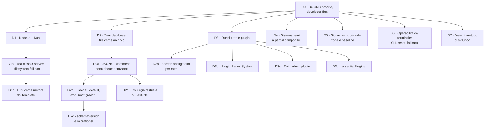

<!-- ital8doc v1-1 · tipo: guide · lang: it · rev: 1 · ref -->
> 🌐 Italian reference edition (always up to date). English `storia-e-albero-delle-scelte.md` is a stub until release.
# Storia e albero delle scelte — ital8cms

Questo documento spiega **perché ital8cms è fatto così**: le decisioni fondative, le alternative scartate, le conseguenze che ogni scelta ha generato. Il **com'è fatto oggi** vive nel documento gemello: [`architettura.it.md`](./architettura.it.md).

---

## 1. Come leggere questo documento

- **È un albero logico, non una cronologia.** I nodi seguono l'ordine delle dipendenze concettuali: ogni decisione poggia su quelle sopra di lei. L'ordine dei commit è un'altra cosa, e la §2 lo racconta a parte.
- **Ogni nodo ha lo stesso formato:** *Decisione* → *Problema* → *Alternative* → *Perché questa* → *Conseguenze* → *Evidenze*.
- **Le fonti sono verificabili:** storia git, `CHANGELOG.md`, i decision record in [`decisions/`](./decisions/), il codice. Ogni nodo le cita.
- **🔍 = ricostruzione a posteriori.** Le decisioni della prima vita del progetto (2023-2025) non hanno un registro scritto. Per quei nodi questo documento ricostruisce il ragionamento dalle evidenze disponibili; le "alternative" sono quelle che la scelta ha oggettivamente escluso, non un verbale di ciò che l'autore valutò davvero. Il maintainer può correggere.
- **Convenzione di scrittura:** questo documento segue il profilo STE-inspired dichiarato in [`architettura.it.md` §0](./architettura.it.md#0-convenzione-di-scrittura), nella variante ibrida: campi strutturati asciutti, prosa libera dove l'argomentazione lo richiede.

---

## 2. La storia in breve: le due vite (più un prologo)

**Prologo (2023).** Prima del CMS esiste il suo mattone: `koa-classic-server` nasce su GitHub e npm il **9 gennaio 2023**, con una missione dichiarata — *"comportamento simile, ma non identico, ad apache2"*. L'autore costruisce un file server per Koa; il CMS arriverà dopo, **attorno** a lui.

**Prima vita — artigianale (feb-apr 2025).** Il 15 febbraio 2025 nasce ital8cms: ~20 commit in tre mesi. Lo stack del primo commit: Koa 2.14, EJS 3, koa-classic-server 1.0.6, koa-session, Bootstrap — e `better-sqlite3`, perché **lo zero-database non era ancora la filosofia**. Il config è un JSON semplice (`ital8-conf.json`); `node_modules` è committato. In questi mesi prendono forma pluginSys, login/logout, i priority middleware, il theme system e l'inizio dell'admin. Poi **sette mesi di pausa**.

**Seconda vita — AI-assisted (dal 19 novembre 2025).** La ripresa ha un atto fondativo rivelatore: **il primo commit è `CLAUDE.md`** — il contratto operativo per gli assistenti AI. Nello stesso giorno: migrazione a Koa 3, **rimozione di better-sqlite3** (lo zero-DB diventa filosofia dichiarata), adozione di **JSON5**. Da lì ~1.040 commit in un anno, a ondate tematiche:

| Periodo | Ondata |
|---|---|
| 2025-11 → 2026-02 | ricostruzione: doc, test, admin, plugin di sicurezza |
| 2026-03 | revisione sistematica ([`project-review`](./decisions/project-review-2026-03.it.md)): bug critici, XSS, open redirect |
| 2026-06 | ciclo di vita dei config ([`config-lifecycle`](./decisions/config-lifecycle.it.md)): sidecar `.default`, boot graceful |
| 2026-07 | migrazioni dei config ([`config-migrations`](./decisions/config-migrations.it.md)) |
| 2026-09 → 2026-11 | `REVIEW.md`, zone dello spazio URL ([`path-zones`](./decisions/path-zones.it.md)), chirurgia JSON5 completa |

Oggi: versione interna v3.38.0, 26 plugin, ~5.400 test. Il filo conduttore della seconda vita: **molte scelte della prima vita sono state ri-fondate** — stessa direzione, fondamenta nuove. L'albero che segue descrive il risultato, e segnala dove una decisione è nata in una vita ed è maturata nell'altra.

---

## 3. L'albero

**Vai al nodo:** [D0](#d0) · [D1](#d1) [D1a](#d1a) [D1b](#d1b) · [D2](#d2) [D2a](#d2a) [D2b](#d2b) [D2c](#d2c) [D2d](#d2d) · [D3](#d3) [D3a](#d3a) [D3b](#d3b) [D3c](#d3c) [D3d](#d3d) · [D4](#d4) · [D5](#d5) · [D6](#d6) · [D7](#d7)

Tutti i nodi sono descritti nelle sezioni che seguono. La sezione **Critiche e suggerimenti** (§11) chiude il documento.

---

## 4. Le fondamenta (D0-D1)

### D0 · Un CMS proprio, developer-first 🔍

- **Decisione.** Costruire un CMS da zero, per sviluppatori, invece di adottarne uno esistente.
- **Problema.** L'autore gestisce siti reali in produzione e vuole controllarne l'intero stack: server, template, dati, deploy.
- **Alternative.**
  - *WordPress*: ecosistema enorme, ma stack PHP+MySQL, filosofia page-builder, e astrazioni che nascondono la macchina. L'esatto contrario dell'obiettivo.
  - *Headless CMS Node (Strapi, Directus)*: stesso runtime, ma DB-centrici e API-first; il rendering resta da costruire altrove.
  - *Generatori statici (Hugo, Eleventy)*: deploy banale, ma niente runtime dinamico, niente pannello, niente plugin server-side.
  - *Ghost, KeystoneJS*: opinionati sul dominio (blog / schema-driven), DB obbligatorio.
- **Perché questa.** Tre ragioni convergono. **Controllo:** nessuna astrazione tra lo sviluppatore e la tecnologia; la filosofia è oggi formalizzata in `CLAUDE.md` ("nessun drag-and-drop; tutta la personalizzazione avviene tramite codice"). **Continuità:** l'autore possedeva già il mattone di base, `koa-classic-server` (→ D1a). **Apprendimento:** capire il proprio CMS fino in fondo è un obiettivo del progetto, non un effetto collaterale — e per un progetto personale "costruirlo è il punto" è una motivazione legittima, che la descrizione del repo rivendica con autoironia: *"the best Cms in the world"*.
- **Conseguenze.** Il pubblico è ristretto per scelta: serve saper programmare. Ogni decisione figlia eredita il criterio "lo sviluppatore deve poter vedere e toccare tutto": niente DB opaco (→ D2), template in HTML+JS puro (→ D1b), config commentabili (→ D2a).
- **Evidenze.** Descrizione del repo GitHub; `CLAUDE.md` → *Filosofia di base*; README → *Core Philosophy*.

### D1 · Node.js + Koa 🔍

- **Decisione.** Runtime Node.js; framework HTTP **Koa**.
- **Problema.** Serve una base HTTP minimale su cui costruire middleware, routing e file serving, in un linguaggio solo (JavaScript ovunque: server, template, client).
- **Alternative.**
  - *Express*: lo standard de facto, ma di generazione pre-`async/await`: la gestione degli errori asincroni passa per `next(err)` e convenzioni fragili.
  - *Fastify*: veloce e moderno, ma opinionato (schema JSON, encapsulation, plugin system proprio) — un CMS che vuole possedere le proprie astrazioni si troverebbe a combatterle.
  - *`http` nudo*: massimo controllo, ma reinventare body parsing, routing e composizione di middleware non è il punto del progetto.
- **Perché questa.** Koa è **piccolo e componibile**: non porta quasi nulla, e quel nulla è esattamente lo spazio che il CMS vuole riempire da sé. Il modello a cipolla con `async/await` nativo rende ogni funzionalità — auth, redirect, rate limit, gate — un middleware componibile. E la scelta **precede il CMS**: `koa-classic-server` (2023) è un middleware Koa; quando ital8cms nasce nel 2025, il framework è già deciso per continuità.
- **Conseguenze.** "Tutto è middleware" diventa la grammatica del sistema: i gate del control plane, il filtro sentinel, i middleware dei plugin. L'**ordine di montaggio** diventa un concetto architetturale di prima classe (→ D3, box `[WEIGHT]`). La scelta CommonJS (ereditata dall'epoca) vieta il top-level await: l'intero boot asincrono vive in `startApp()`.
- **Evidenze.** `package.json` del primo commit (Koa 2.14, `@koa/router` 12); migrazione a Koa 3 il 2025-11-19 (commit "Migrazione a Koa v3.1.1 e koa-classic-server v2.1.2"); [`archive/koa-v3-migration.it.md`](./archive/koa-v3-migration.it.md).

### D1a · koa-classic-server: il filesystem è il sito

- **Decisione.** Il serving delle pagine non passa da rotte: lo fa un file server "stile Apache", **`koa-classic-server`**, scritto e mantenuto dallo stesso autore.
- **Problema.** Un CMS file-based ha bisogno della semantica dei web server classici: directory → URL, file indice, listing opzionale, estensioni nascoste, e soprattutto **un hook di render** (un `.ejs` richiesto via URL va renderizzato, non servito come testo).
- **Alternative.**
  - *`koa-static` / `koa-send`*: servono file statici e basta. Niente render hook, niente `urlsReserved`, niente dirListing in stile Apache. Il CMS avrebbe dovuto avvolgerli fino a riscriverli.
  - *Rotte esplicite per ogni pagina*: nega il modello "metto un file in `www/` ed esiste" (→ D0: lo sviluppatore vede e tocca tutto).
  - *Un file server di terzi ricco*: esisteva poco nel 2023, e ogni esigenza nuova avrebbe richiesto fork o workaround.
- **Perché questa.** Il modulo **esisteva già** (gennaio 2023) ed era nato proprio per questo: *"comportamento simile, ma non identico, ad apache2"*. Costruirci sopra il CMS significa che ogni esigenza del CMS può diventare una feature del modulo: `template.render` è il punto esatto in cui ital8cms inietta EJS e `passData`; `urlsReserved` è ciò che fa convivere cinque istanze sullo stesso spazio URL (→ [`architettura.it.md` §3.2](./architettura.it.md)).
- **Perché il mantenimento in proprio è una regola scritta.** Con lo stesso maintainer da entrambi i lati, la tentazione del workaround locale è forte — e infatti è vietata: un bug di koa-classic-server si corregge **nel modulo** e si aggiorna la dipendenza (`CLAUDE.md` → *Dipendenze Mantenute dal Team*). Il caso reale è documentato in `index.js`: fino alla 5.1.0, spegnere il dirListing rompeva la ricerca del file indice; la correzione è andata nel modulo (5.2.0), non in un `if` dentro ital8cms.
- **Conseguenze.** Il CMS registra render per estensione, non rotte per pagina. Il modulo è cresciuto col CMS (dalla 1.0.6 alla 5.3.0, quattro salti di major). Il rovescio: un componente critico con **un solo maintainer** — rischio discusso nella sezione critiche.
- **Evidenze.** npm: `koa-classic-server` creato 2023-01-09; `package.json` del primo commit (v1.0.6); commento in `index.js` sul fix 5.2.0; `CLAUDE.md`.

### D1b · EJS come motore dei template 🔍

- **Decisione.** Le pagine dinamiche sono file **EJS**: HTML con JavaScript incorporato. Nessun build step.
- **Problema.** Serve un motore di template per pagine, partial dei temi e sezioni admin, coerente con il criterio di D0: lo sviluppatore scrive ciò che conosce già.
- **Alternative.**
  - *Pug*: sintassi a indentazione da imparare; l'HTML scompare. Contro la filosofia.
  - *Handlebars / Mustache*: logic-less per principio; ma le pagine di ital8cms chiamano API dei plugin, iterano strutture, compongono partial con parametri — la logica serve.
  - *Nunjucks*: potente, ma un linguaggio di template a sé, con il proprio runtime.
  - *JSX / componenti + build*: introduce il build step che D0 rifiuta.
- **Perché questa.** EJS è **il motore che non è un linguaggio**: dentro `<% %>` c'è JavaScript vero, e fuori HTML vero. L'`include` componibile è esattamente il meccanismo dei partial dei temi. Il render asincrono (`ejs.renderFile` con `await` dentro i tag) si incastra nel render hook di koa-classic-server.
- **Conseguenze.** I temi sono cartelle di partial EJS (→ D4). I plugin espongono funzioni ai template (`passData.plugin.*`, helper globali con whitelist → D3). La sicurezza XSS diventa una **convenzione d'uso** (`<%= %>` escapa, `<%- %>` no) presidiata da review e utility `escapeHtml` — non una proprietà del motore. Curiosità onesta: Handlebars è comunque in `package.json`, usato da `simpleI18n` per i template delle traduzioni — scelta locale di un plugin, non un ripensamento del motore.
- **Evidenze.** EJS 3 nel primo commit (oggi v6); `index.js` → `template.render`; `plugins/simpleI18n` per l'uso di Handlebars.

---

## 5. I dati (D2)

### D2 · Zero database: i file sono l'archivio

- **Decisione.** Il core non richiede alcun DBMS. Dati strutturati in file JSON5, contenuti su filesystem. Un database è un **plugin opzionale** (`dbApi`), spento di default.
- **La storia vera, prima del perché.** Questa è la decisione più istruttiva dell'albero, perché **non è nata con il progetto: è una conversione.** Il primo commit (feb 2025) includeva `better-sqlite3` tra le dipendenze e un plugin `dbApi` destinato a servirlo. Il 19 novembre 2025 — primo giorno della seconda vita — tre commit consecutivi rimuovono la dipendenza, disabilitano il plugin e riscrivono la documentazione attorno alla "filosofia file-based senza database". La prima vita *aveva* il database; la seconda ha deciso che non le serviva.
- **Problema.** Un CMS per siti piccoli e medi deve persistere utenti, ruoli, configurazioni e contenuti. Un DBMS obbligatorio ha costi sproporzionati a quella scala: installazione, backup specializzato, un file binario opaco — e `better-sqlite3` aggiunge la **compilazione nativa**, attrito concreto a ogni `npm install` e a ogni major di Node (l'autore lavora su NixOS, dove l'attrito raddoppia).
- **Alternative.**
  - *SQLite embedded di default*: query vere e transazioni, ma build nativa, dati non leggibili a occhio, backup non banale. È rimasta disponibile come **opt-in** (`dbApi`), che è il modo più onesto di scartare un'alternativa: lasciarle la porta aperta.
  - *lowdb / NeDB*: "database JSON" che aggiungono un'API e una dipendenza sopra ciò che `fs` fa già.
  - *PostgreSQL / MongoDB*: fuori scala per il dominio dichiarato.
- **Perché questa.** Il deploy diventa **copiare una cartella**; il backup un `cp` (→ D6); ogni dato è leggibile, modificabile a mano, confrontabile in Git. La coerenza interna conta quanto i benefici: se "il filesystem è il sito" (D1a), che anche i dati siano filesystem chiude il cerchio.
- **Limiti dichiarati (non scoperti dopo).** La documentazione delimita il dominio: "dataset piccoli e medi". Due confini reali: niente query complesse (chi le vuole accende `dbApi`), e **niente lock tra processi** — l'architettura regge un processo solo (`REVIEW.md` B7; → critiche).
- **Conseguenze.** Le scritture devono essere **atomiche** (temp + rename, ovunque). I plugin dichiarano le loro data dir (`getWritablePaths`), sondate al boot con una scrittura reale. E l'intera filiera D2a→D2d esiste perché i file sono diventati il database: quando l'archivio è testo, *la qualità del testo è integrità dei dati*.
- **Evidenze.** `package.json` del primo commit (better-sqlite3 presente); commit del 2025-11-19 ("Rimuovi dipendenza better-sqlite3 e disabilita plugin dbApi", "Aggiorna documentazione: filosofia file-based senza database"); `CLAUDE.md` → *Strategia di archiviazione dati*; `REVIEW.md` → B7.

### D2a · JSON5: i commenti sono documentazione

- **Decisione.** Tutti i file di configurazione sono **JSON5**, letti da un solo modulo (`loadJson5`). Ogni config porta commenti; la prima riga dichiara lo standard.
- **Problema.** Un config senza commenti non si spiega da solo — e in un CMS developer-first i config **sono** l'interfaccia utente. JSON vieta i commenti.
- **Alternative.**
  - *YAML*: commenti sì, ma indentazione semanticamente fragile e coercizioni di tipo sorprendenti (`no` → `false`); una riga storta è un config diverso, non un errore.
  - *TOML*: ottimo per config piatte, scomodo per le strutture annidate che i plugin usano ovunque (`custom.*`).
  - *File JS (`config.js`)*: commenti e potenza massima, ma un config eseguibile non è più un dato: non si valida, non si migra, non si edita in sicurezza da una GUI.
  - *JSON + chiavi `_comment`*: il tributo che si paga quando il formato combatte l'esigenza.
- **Perché questa.** JSON5 è **JSON con i diritti civili**: commenti, virgole finali, chiavi senza virgolette — e resta un formato di *dati*, parsabile e serializzabile. La frase guida del progetto ("nei config i commenti sono la documentazione") diventa sostenibile senza cambiare paradigma.
- **Conseguenze.** `require()` non capisce JSON5 → nasce il lettore unico `loadJson5`, e la regola è vincolante in `CLAUDE.md`. Eccezione dichiarata: i file di **dati** (`userAccount`, `userRole`) sono riscritti per intero dal codice e non conservano commenti — la loro documentazione vive nei `.default`. E soprattutto: se i commenti sono documentazione, **perderli in scrittura è perdita di dati** → D2d.
- **Evidenze.** Commit 2025-11-19 "Aggiungi dipendenza JSON5 per file di configurazione con commenti" (prima: `ital8-conf.json`, JSON puro); `CLAUDE.md` → *File di configurazione JSON5*.

### D2b · Sidecar `.default`, stati dei plugin, boot graceful

- **Decisione.** Ogni config esiste in coppia: `x.default.json5` committato (fonte di verità) + `x.json5` vivo git-ignored, materializzato al boot. I plugin hanno stati espliciti (`available`/`disabled`/`incomplete`/`installed`); il boot **degrada con grazia** invece di fallire; i soli `essentialPlugins` restano fatali; l'assenza del config globale è un gate che rimanda al wizard.
- **Problema.** Tre difetti convivevano (ADR, giugno 2026): i default si perdevano alla prima modifica (i vivi erano committati); `isInstalled` esisteva senza semantica; il boot era fail-fast — *un* plugin con una dipendenza mancante spegneva l'intero sito.
- **Alternative (dall'ADR, qui le più istruttive).**
  - *Hash del default per rilevare il drift*: scartato — misura i valori, non la struttura: falsi positivi a ogni modifica legittima.
  - *Materializzare anche `ital8Config` mancante*: scartato — un progetto mai configurato partirebbe in silenzio coi default, scavalcando il wizard. La sua assenza **deve** fermare il boot.
  - *Stato dei plugin solo in memoria*: scartato a favore della persistenza nel vivo (Variante 1), che traccia anche il setup one-shot (`installPlugin()` gira solo alla transizione 0→1).
- **Perché questa.** Il principio è uno: **separare ciò che il progetto distribuisce da ciò che l'installazione modifica.** Il pacchetto diventa "vergine" (solo `.default`); il reset è cancellare i vivi; un clone fresco si auto-ripara al boot. E il boot graceful ribalta la fail-fast della prima vita con un criterio esplicito: *"un plugin rotto non deve togliere il sito a chi l'ha installato"* — salvo quelli senza i quali il sito non è sicuro (`adminUsers`, `adminAccessControl`, `admin`), per cui vale l'inverso: *"un sito con l'auth rotta non va servito"*.
- **Conseguenze.** Lo stato di un plugin è **ricalcolato a ogni boot** (idempotente: risolvi le dipendenze → `incomplete` diventa `installed` da sé). I box diagnostici (`[INIT]`, `[PLUGINS]`, `[SCHEMA]`…) diventano il linguaggio del boot. Le terze parti si adeguano: un repo di plugin committa solo i `.default` (Fase 6 dell'ADR). Il costo: sei fasi di migrazione del repo e una complessità del ciclo di vita che va saputa (→ critiche).
- **Evidenze.** [`decisions/config-lifecycle.it.md`](./decisions/config-lifecycle.it.md) (design 2026-06-25, fasi 0-6 complete); PR #306.

### D2c · `schemaVersion` e `migrations/`: i config che evolvono

- **Decisione.** Ogni config versionabile porta una `schemaVersion` (intero, versione della *struttura*). Le aggiunte di chiavi si propagano da sole (merge additivo al boot); rinomine, rimozioni e cambi di valore richiedono una **migrazione dichiarata** (`migrations/` nel pacchetto), rilevata al boot e applicata **solo su comando** (`cli migrate`; auto-apply opt-in).
- **Problema.** Con i vivi git-ignored, l'aggiornamento del software non aggiorna più i config degli utenti. Il primo ponte — merge additivo delle sole chiavi top-level — **non reggeva, e il fallimento è misurato**: tre bump reali su quattro non produssero l'effetto atteso (chiavi annidate e cambi di valore non propagati — tabella nell'ADR).
- **Alternative.**
  - *Persistere "l'ultima versione vista"*: scartato — con il descrittore come *clock*, lo stato dell'installazione **è** la `schemaVersion` del vivo. Nessun registro parallelo da tenere allineato.
  - *Applicare le migrazioni al boot*: scartato — "un boot che modifica i config in silenzio rende impossibile capire cosa è successo quando qualcosa si rompe". Il boot **rileva e nomina** (box `[MIGRATE]`); la mano che applica è quella dell'operatore.
  - *Agganciare le migrazioni a `upgradePlugin()`*: scartato — i temi non hanno `main.js`: resterebbero scoperti. Il runner vive nel core.
- **Perché questa.** La `schemaVersion` avanza **solo a esito riuscito**: "è una ricevuta, non un contatore di tentativi". Le tre strategie (merge, script, migrazione manuale guidata da un `.md` azionabile) si derivano dai campi esistenti, senza flag nuovi. `reason` è obbligatorio sempre: ogni migrazione dichiara il proprio perché.
- **Conseguenze.** Un config con migrazione pendente è **escluso** dal merge additivo (che brucerebbe il trigger). Il backup precede ogni step. Il bump del descrittore diventa un gesto consapevole dello sviluppatore — la decisione "la struttura è cambiata" resta umana.
- **Evidenze.** [`decisions/config-migrations.it.md`](./decisions/config-migrations.it.md) (2026-07-30); `CHANGELOG.md` v2.66.0-v2.67.0; `core/migrationRunner.js`.

### D2d · Chirurgia testuale sui JSON5

- **Decisione.** Il core **non riscrive mai** un config per aggiornarlo: lo modifica con operazioni chirurgiche sul testo — sei operazioni (`loadJson5`, `editJson5`, `setJson5Key`, `removeJson5Key`, `renameJson5Key`, su base `json5Scan`) — e dichiara in `droppedComments` ciò che una sostituzione non ha potuto preservare.
- **Problema.** `JSON5.parse` + `stringify` perde i commenti, per costruzione: un parser produce valori, e i commenti non sono valori. Per qualunque altro progetto è un dettaglio; qui, dopo D2a, è **perdita di dati** — i commenti *sono* la documentazione dei config.
- **Alternative.**
  - *Un parser CST / comment-preserving di terze parti*: avrebbe messo una dipendenza esterna nel punto più delicato della filiera (i file che governano accessi e sicurezza), per un problema che cresce bene in modo incrementale.
  - *"Niente commenti nei file vivi"*: la resa — nega D2a.
  - *Riscrittura completa + commenti rigenerati da uno schema*: i commenti smettono di appartenere all'utente.
- **Perché questa (e la sua storia, che è il vero argomento).** Lo strato non è nato da un disegno: è nato **a buchi, e ogni buco ha fatto danni misurati.** La rimozione mancante venne riscritta a mano dentro una migrazione (`dropRuleBlock`) con due difetti di perdita dati confermati; le rinomine testuali con `String.replace` corrompevano i config (ancora dentro i commenti, prima occorrenza soltanto — entrambi i casi riprodotti). La risposta, documentata con rara onestà nel CHANGELOG (v3.33-v3.37), è stata completare lo strato invece di rattoppare i call site: la sesta operazione (`renameJson5Key`) dissolse una famiglia di guasti — "un file riformattato ora si converte, invece di essere dichiarato non convertibile". Il principio consolidato: *"un commento perso in silenzio è il difetto; uno perso e dichiarato è una conseguenza"*.
- **Conseguenze.** Ogni scrittura di config del core e delle migrazioni passa dallo strato (regola in `CLAUDE.md`). La GUI admin può offrire l'editor raw (vista B delle Tre Viste) sapendo che il salvataggio non distrugge il file. Il costo: ~2.100 righe di scanner testuale di proprietà del progetto, con la loro superficie di bug — pagata, a giudicare dal CHANGELOG, con una campagna di test e mutazioni insolitamente rigorosa.
- **Evidenze.** [`decisions/json5-key-operations.it.md`](./decisions/json5-key-operations.it.md) (2026-11-01); `CHANGELOG.md` v3.33.0-v3.37.0 (rilievi 1-6, con mutazioni verificate).

---

## 6. L'architettura a plugin (D3)

### D3 · Quasi tutto è plugin

- **Decisione.** Le funzionalità vivono in plugin con un contratto uniforme (`main.js` + descrittore). Il core carica, ordina, sorveglia e mette in comunicazione; non implementa feature. Vale anche per la sicurezza (auth, access control, CSRF, rate limit) e per gran parte del pannello admin.
- **Problema.** Un CMS cresce per accumulo di funzionalità. Se crescono nel core, ogni funzionalità diventa obbligatoria per tutti, e ogni modifica rischia tutte le altre.
- **Alternative.**
  - *Core monolitico con feature flag*: le funzionalità restano accoppiate; "spento" non è "assente".
  - *Sistema a hook/filtri stile WordPress*: estensibile, ma il punto di estensione è una foresta di hook sparsi nel core; il contratto è implicito.
  - *Microkernel a servizi*: concettualmente simile, più cerimonia di quanta ne serva a un CMS file-based.
- **Perché questa.** Il contratto esplicito rende ogni plugin una cartella **autosufficiente**: codice, config con sidecar, dipendenze npm proprie, test propri, documentazione propria. Installare è copiare la cartella; disinstallare è rimuoverla. E un contratto unico è imparabile: chi ha scritto un plugin li sa leggere tutti.
- **Conseguenze.** Il prezzo è un contratto ricco (una decina di export possibili) e **l'ordine come concetto architetturale**: dipendenze dure + `weight` + alfabetico, in un unico ordinamento topologico. La conseguenza meno ovvia — *l'ordine di caricamento è anche l'ordine dei middleware* — è costata un difetto reale: `analytics` perse il 100% dei redirect dalle statistiche quando l'ordinamento cambiò (v3.0.0), finché il suo peso non fu corretto (v3.10.0); oggi l'invariante ha un test col proprio nome (`middlewareOrder.test.js`) e il boot dichiara i pesi non onorabili (box `[WEIGHT]`).
- **Evidenze.** Il pluginSys esiste dal decimo giorno di vita del progetto (commit 2025-02-25, "iniziato a lavorare sul plugin simple access con modifiche anche al pluginsys"); `CLAUDE.md` → *Architettura del sistema plugin*; [`core/EXPLAIN-pluginsSys.it.md`](../core/EXPLAIN-pluginsSys.it.md).

### D3a · `access` obbligatorio per rotta

- **Decisione.** Ogni rotta API dichiara il campo `access`. Una rotta senza `access` valido **non viene registrata**: warning al boot che nomina plugin, metodo e path; il boot prosegue.
- **Problema.** Tre modi di sbagliare una rotta avevano tre esiti diversi, **tutti silenziosi** — e il peggiore era proprio su `access`: la rotta veniva registrata *senza* il wrap di autenticazione, funzionante e aperta. `CLAUDE.md` prometteva un "errore fatale al boot" che nel codice non è mai esistito: la documentazione descriveva una protezione immaginaria.
- **Alternative.**
  - *Errore fatale al boot*: coerente con la promessa originale, ma contraddice il boot graceful — una rotta malformata in un plugin di terze parti non deve togliere il sito a chi l'ha installato.
  - *Default-deny (registrare con `requiresAuth: true`)*: la rotta esisterebbe con un comportamento che nessuno ha scritto; il difetto diventerebbe un mistero di runtime invece di un warning di boot.
  - *Controllo solo nei test o in lint*: protegge il repo, non le installazioni.
- **Perché questa.** È la forma giusta di *fail-closed*: la rotta sbagliata **non esiste** — e una rotta che non esiste non è aperta. L'errore è rumoroso (warning nominativo), locale (le altre rotte vivono), e coerente con la filosofia del boot (D2b).
- **Conseguenze.** I tre errori (metodo minuscolo, `func` invece di `handler`, `access` mancante) hanno oggi **la stessa risposta**. Lo sweep `routeContract.test.js` verifica ogni plugin attivo **con lo stesso predicato usato dal dispatcher** — perché validatore e dispatcher erano già tornati a divergere una volta, proprio su `access`.
- **Evidenze.** `CLAUDE.md` → tabella "tre modi di sbagliare una rotta" (v3.0.0 e v3.14.0); `tests/integration/routeContract.test.js`.

### D3b · Plugin Pages System

- **Decisione.** Un plugin serve pagine pubbliche creando una directory `webPages/`: il core la rileva e crea un symlink sotto `/pluginPages/{plugin}/`. Le **GET** sono servite dalla catena static col render normale; le **POST** e le azioni restano rotte API.
- **Problema.** Prima, ogni pagina HTML di un plugin richiedeva una rotta GET scritta a mano: boilerplate ripetuto, template fuori dal circuito dei temi, e la tentazione di copiare i file in `www/` (duplicazione che si disallinea al primo aggiornamento).
- **Alternative.**
  - *Rotte GET per pagina*: il boilerplate che si voleva eliminare.
  - *Copia dei file in `www/` all'installazione*: duplicazione; l'aggiornamento del plugin non aggiorna il sito.
  - *Middleware dedicato che risolve le directory dei plugin a ogni richiesta*: logica di serving duplicata rispetto a koa-classic-server, che già sa fare tutto (indici, estensioni, render).
- **Perché questa.** Il symlink è **zero-duplicazione per costruzione**: il file servito *è* il file del plugin. E riusa l'intera macchina esistente: stesso render, stesso `passData`, stessi partial del tema. Il costo è la gestione dei symlink (validazione e auto-pulizia al boot) e la compatibilità filesystem.
- **Conseguenze.** Nasce il punto d'incontro fra plugin e temi: il tema personalizza la pagina del plugin senza toccarla (`pluginsEndpointsMarkup/`, metodi `injectPlugin*`). Lo stesso meccanismo symlink è riusato dal pannello admin per le sezioni (→ D3c).
- **Evidenze.** [`core/EXPLAIN-pluginPages.it.md`](../core/EXPLAIN-pluginPages.it.md); `core/pluginPagesSystem.js`.

### D3c · Il pannello admin come plugin: twin e symlink

- **Decisione.** Il pannello è un guscio del core riempito da plugin `admin*` (rilevamento per prefisso del nome). Un plugin di servizio **non contiene la propria GUI**: la distribuisce come plugin gemello `admin<Nome>`. Le sezioni arrivano via symlink; i metadata UI (label, icone, ordine del menu) stanno centralizzati in `adminConfig.json5`.
- **Problema.** Dove vive la GUI di gestione di un plugin? Dentro il plugin, lo appesantisce e lo lega al pannello; nel core, il core torna a crescere per accumulo (l'anti-D3).
- **Alternative.**
  - *GUI dentro il service plugin*: era il pattern iniziale (`adminUsers`, `adminAccessControl` lo conservano come eccezioni storiche, perché il loro dominio è admin-centrico). Non scala: ogni service si porta dietro la GUI anche dove non serve.
  - *GUI nel core*: il core dovrebbe conoscere ogni plugin.
  - *Niente GUI, solo config a mano*: coerente col developer-first, ma il pannello esiste proprio per le operazioni quotidiane (utenti, media, regole).
- **Perché questa.** Il twin rende il service **headless** (installabile senza GUI, zero dipendenze admin) e la GUI **sacrificabile** (disattivabile senza toccare la logica). Le coppie consolidate lo dimostrano: `seo`/`adminSeo`, `media`/`adminMedia`, `analytics`/`adminAnalytics`, `rateLimiter`/`adminRateLimiter`, `bootstrapNavbar`/`adminBootstrapNavbar`.
- **Conseguenze.** Serve una filosofia di GUI condivisa perché il pannello resti coerente: le **Tre Viste** (data view / editor JSON5 raw / form strutturato, coordinate sullo stesso file — [`architettura.it.md` §7.3](./architettura.it.md)). L'editor raw come "verità di base" discende direttamente da D2a+D2d: si può offrire solo perché il salvataggio non distrugge i commenti. L'init a 2 fasi (dependency injection reciproca pluginSys ↔ adminSystem) risolve la circolarità fra i due sistemi.
- **Evidenze.** `CLAUDE.md` → *Best Practice Twin Admin Plugin* e *Le Tre Viste*; [`core/admin/EXPLAIN.it.md`](../core/admin/EXPLAIN.it.md).

### D3d · `essentialPlugins`: il confine del graceful

- **Decisione.** Una lista centrale in `ital8Config.json5` (default: `adminUsers`, `adminAccessControl`, `admin`) marca i plugin **essenziali**: se uno di loro non carica, il boot termina con box `[FATAL]`. Il loro reset richiede conferma rafforzata.
- **Problema.** Il boot graceful (D2b) crea un rischio nuovo: se *tutto* degrada con grazia, degrada anche l'autenticazione — e un sito servito **senza** auth e access control è peggio di un sito spento.
- **Alternative.**
  - *Nomi hardcoded nel core*: stessa protezione, ma invisibile e non adattabile (un'installazione con un plugin di auth alternativo non potrebbe dichiararlo).
  - *Tutti i plugin di sicurezza essenziali*: scartato nel design — `csrfProtection` degrada con warning, perché la sua assenza riduce la difesa in profondità ma non apre la porta.
  - *Nessuna eccezione al graceful*: inaccettabile per definizione.
- **Perché questa.** I due principi del boot si completano: *"un plugin rotto non deve togliere il sito"* e *"un sito con l'auth rotta non va servito"*. La lista è il confine esplicito fra i due — visibile, commentata, e difesa anche sul fronte del reset (il lockout del root è un rischio documentato).
- **Evidenze.** [`decisions/config-lifecycle.it.md`](./decisions/config-lifecycle.it.md) §4; `index.js`; `CLAUDE.md` → *Stati dei plugin*.

---

## 7. I temi (D4)

### D4 · Sistema temi a partial componibili

- **Decisione.** Un tema è un pacchetto di **partial EJS** (`head`, `header`, `nav`, `main`, `aside`, `footer`), template completi e risorse statiche. Due temi attivi convivono — sito pubblico e pannello admin — e l'attivazione vive **solo** in `ital8Config.json5`. Il tema personalizza le pagine dei plugin dall'esterno (`pluginsEndpointsMarkup/`).
- **Problema.** Separare la presentazione dalla logica e dal contenuto, così che il restyling non tocchi plugin né pagine — e che una pagina di plugin scritta una volta stia bene sotto qualunque tema.
- **Alternative.**
  - *Tema unico per sito e pannello*: rompere il sito romperebbe anche lo strumento che serve a ripararlo. La separazione riduce il raggio dell'esplosione.
  - *Ereditarietà parent/child stile WordPress*: potente ma complessa (risoluzione a cascata, override parziali). Il modello piatto + `pluginsEndpointsMarkup` copre il caso d'uso reale — "ritocco l'aspetto di una pagina di plugin" — senza gerarchie.
  - *Theming solo CSS*: insufficiente — i temi di ital8cms decidono anche la struttura (i partial), non solo l'aspetto.
- **Perché questa.** L'`include` di EJS è già un sistema di composizione: il tema espone pezzi, la pagina li monta. L'**API unificata** (`getThemePartPath` / `getThemeResourceUrl`, che scelgono il tema da `passData.isAdminContext`) permette alla stessa pagina di vivere nei due contesti senza saperlo.
- **Conseguenze.** Il campo `active` nei temi è stato **rimosso** quando si è scoperto che era un secondo source-of-truth cosmetico e ambiguo (un tema poteva dichiararsi attivo senza esserlo): la fonte è una sola, `ital8Config`. Il ciclo di vita si è allineato ai plugin (descrittore `.default`, vivo git-ignored, bundled "installati per definizione"). Lo scaffolding ha uno standard di segnaposti (`PLACEHOLDER_Standard_ital8cms`) per generare temi coerenti.
- **Evidenze.** Il theme system esiste dalla prima vita (commit del 2025-03-20 sul rifacimento del theme system e dell'admin theme); [`decisions/theme-active-isinstalled.it.md`](./decisions/theme-active-isinstalled.it.md); [`core/EXPLAIN-themeSys.it.md`](../core/EXPLAIN-themeSys.it.md).

---

## 8. La sicurezza strutturale (D5)

### D5 · Zone e baseline: la sicurezza esce dai file

- **Decisione.** Lo spazio URL è partizionato in **zone** (una per prefisso configurabile) e ogni zona porta il suo minimo d'accesso — il **`baseline`** — **in codice**. I pattern scritti dall'utente nominano le zone con segnaposti (`{{admin}}/**`). La superficie riservata è **derivata** (l'insieme delle zone che chiedono auth), e le invarianti sono verificate al boot con sonde sull'**effetto**, non sulla forma dei file.
- **Problema: il difetto A1, la lezione fondativa.** La protezione del pannello era scritta come testo (`"/admin/**"`) in un file di regole, ma la posizione del pannello era una variabile (`adminPrefix`), modificabile da wizard e GUI. Nessun codice sincronizzava le due cose: cambiare il prefisso in `backoffice` spostava le pagine dove nessuna regola matchava — e la `defaultPolicy` era `allow`. Aggravanti verificate: le pagine admin non avevano guardia propria, il dirListing del pannello era acceso, e un commento nel codice presentava `adminPrefix` come misura di sicurezza. Sintesi dell'ADR: **"chi lo cambia lo fa credendo di aumentare la sicurezza e ottiene l'esatto contrario: la mossa difensiva è quella che apre la porta."**
- **Alternative.**
  - *Strada A, "riparare il foglietto"*: iniettare le regole hardcoded da codice nel motore. Scartata con una prova del nove: con `accessControl.json5` cancellato o corrotto, il motore resta senza regole e il pannello si apre comunque. Un'invariante che vive in un file mutabile non è un'invariante.
  - *Sincronizzare `adminPrefix` nelle regole a ogni cambio*: cura il sintomo (quel prefisso) e lascia la classe scoperta — i prefissi configurabili sono sette, e i file con letterali di prefisso erano quattro con venti occorrenze.
  - *Congelare i prefissi*: rinuncia a una configurabilità già promessa.
- **Perché questa.** La strada B — "costruire il muro" — rende la protezione **non cancellabile perché non c'è più niente da cancellare**: il baseline della zona `admin` sta nel codice del core. I due problemi distinti sotto A1 ricevono due cure distinte: l'invariante esce dai file (P1), e le regole utente guadagnano i segnaposti per *nominare* le zone senza cablare i prefissi (P2).
- **Conseguenze.** Sette fasi di implementazione. La derivazione del perimetro ha ripagato subito: il reserved gate, che prima interrogava **due prefissi scritti a mano**, derivandolo dalla mappa ha scoperto che l'elenco manuale **perdeva la zona `views`** — una fuga reale, misurata su un'istanza viva (un redirect al login dove doveva esserci un 404). `accessInvariantCheck` chiude A3 con le sonde: "cosa risponderebbe il sistema a questa richiesta?" sopravvive a qualunque refactoring, mentre un controllo sulla forma del file no.
- **Evidenze.** [`decisions/path-zones.it.md`](./decisions/path-zones.it.md); `REVIEW.md` → A1, A3; `CHANGELOG.md` v3.38.0; `core/pathZoneResolver.js`, `core/accessInvariantCheck.js`.

---

## 9. L'operabilità (D6)

### D6 · Operare da terminale: CLI su socket, reset offline, fallback

- **Decisione.** Un'istanza si pilota da terminale: **control plane su socket UNIX** (`cliBridge`) per l'istanza viva — stati di admin/pubblico/superficie riservata commutati a caldo — e comandi **offline** (reset, migrate) che agiscono sul filesystem a server spento. HTTPS con **fallback a HTTP** su certificato invalido; self-update e backup da terminale; prima configurazione via wizard.
- **Problema.** Un CMS self-hosted si guasta **quando la GUI non è raggiungibile**: config corrotta che impedisce il boot, certificato scaduto, pannello da chiudere in fretta. L'unica console sempre disponibile è SSH.
- **Alternative.**
  - *Gestione solo da GUI admin*: circolare — la GUI è dentro il sistema che stai riparando.
  - *API di management su HTTP*: stessa circolarità (se HTTP è giù...), più una superficie di attacco nuova da autenticare.
  - *Variabili d'ambiente + restart*: nessuna commutazione a caldo, nessuno stato interrogabile, e "spegni il pannello" diventerebbe "riavvia tutto".
  - *Delegare tutto al supervisor (systemd/PM2)*: il supervisor riavvia processi; non sa cosa sia una superficie riservata.
- **Perché questa.** Il socket UNIX è locale per costruzione (niente rete, permessi del filesystem) e **indipendente dal server HTTP**: funziona anche con il sito in manutenzione. La coppia online/offline copre entrambe le metà del problema: pilotare un'istanza viva e salvare un'istanza morta. Il fallback HTTPS→HTTP segue lo stesso principio del boot graceful: un certificato rotto non deve spegnere il sito, deve urlare in console.
- **Conseguenze.** I **gate pre-router** (D5) sono l'attuatore della CLI: `public stop` → 503 uniforme, `reserved stop` → 404 secco, `publicOnly` → assetto vetrina. Lo stato persiste su file e sopravvive ai riavvii. L'infrastruttura di restart (self-respawn o delega al supervisor) è riusata dai plugin (`requestRestart`) e dal reset online. Dettaglio diventato regola documentata: con `npm run cli` i flag vanno dopo `--`, perché npm li ingoia **senza errore**.
- **Evidenze.** [`cli-control-plane.it.md`](./cli-control-plane.it.md); `core/cliBridge/`; `index.js` (scenari HTTPS); [`backup-strategie.it.md`](./backup-strategie.it.md) · [`self-update.it.md`](./self-update.it.md).

---

## 10. Meta: il metodo di sviluppo (D7)

### D7 · Il repo come memoria condivisa uomo+AI

- **Decisione.** Il progetto è sviluppato in coppia uomo+AI, e il metodo è **esternalizzato nel repo** come insieme di contratti scritti: `CLAUDE.md` (regole operative vincolanti), lo standard di documentazione **ital8doc**, i **decision record**, un **CHANGELOG forense** (ogni voce: cosa, perché, come verificato, cosa resta fuori), `REVIEW.md` (auto-audit con gravità), `TODO.md` (debito con fonte), e la regola del **naming approvato**: l'AI propone alternative, il maintainer sceglie ogni nome.
- **Problema.** Lo sviluppo AI-assistito su un progetto grande ha un punto debole strutturale: l'assistente **non ricorda** tra le sessioni. Senza memoria esterna, le convenzioni derivano, le decisioni si riprendono da capo, e lo stile di mille commit diverge.
- **Alternative.**
  - *Prompting ad-hoc per sessione*: la deriva è questione di settimane.
  - *Convenzioni solo nella testa del maintainer*: funziona finché c'è un solo cervello e nessun assistente.
  - *Documentazione tradizionale (descrittiva, non operativa)*: descrive il sistema ma non **istruisce** chi ci lavora; un contratto operativo dice "fai così, mai cosà" con le conseguenze.
- **Perché questa.** Il primo commit della seconda vita **è** `CLAUDE.md`: il metodo precede il codice. Da lì, il repo è la memoria condivisa — e funziona in entrambe le direzioni: vincola l'AI (loadJson5 sempre, `access` obbligatorio, naming approvato) e vincola il maintainer (le decisioni passano da un record, i difetti da `REVIEW.md`). La regola del naming merita una nota: tiene **la scelta dei nomi** — cioè il vocabolario del progetto — nelle mani dell'umano, che è il modo più economico di mantenere la proprietà intellettuale del design mentre l'AI scrive la maggior parte del codice.
- **Conseguenze.** ~1.040 commit in un anno con convenzioni stabili. Un CHANGELOG che documenta anche gli errori dell'assistente (v3.37: *"corretta un'affermazione falsa che avevo scritto io… l'avevo giudicata sicura senza provarla"*) — il metodo prevede che l'AI si smentisca per iscritto. I costi: una mole documentale che va mantenuta (CLAUDE.md da solo supera le 1.700 righe), e l'italiano come lingua di riferimento — coerente con il maintainer, ma una barriera per contributor esterni (→ critiche). Questo stesso documento, col suo profilo di scrittura dichiarato, è un artefatto del metodo.
- **Evidenze.** Storia git del 2025-11-19; `CLAUDE.md` → *Linee guida per l'assistente AI*; [`ITAL8DOC-latest.md`](./ITAL8DOC-latest.md); `CHANGELOG.md` (stile delle voci v3.3x); `REVIEW.md` · `TODO.md`.

---

## 11. Critiche e suggerimenti

> **Perimetro e metodo.** Questa sezione critica le **scelte**, non il codice: i difetti puntuali hanno già la loro sede ([`REVIEW.md`](../REVIEW.md)) e qui vengono citati solo come evidenza. Ogni critica dichiara gravità (**S** strutturale / **M** media / **C** cosmetica), il rischio concreto e un suggerimento attuabile. Il giudizio complessivo, detto subito: per essere il progetto personale di un maintainer solo, il livello di rigore — decision record, CHANGELOG forense, 5.400 test, un'auto-revisione impietosa — è fuori scala. Le critiche che seguono sono quelle che farei a un progetto serio, perché lo è.

### Strutturali

#### S1 · Il contenuto è codice: il "CMS" gestisce poco contenuto

La parola CMS promette gestione di *contenuti*; in ital8cms le pagine sono **file EJS scritti da sviluppatori**. Non esiste un content model (post, collezioni, campi), né un workflow editoriale, né un posto dove un non-programmatore scriva un testo. I ruoli `editor` e `selfEditor` promettono permessi su contenuti che il core oggi non modella.

- **Rischio:** aspettative sbagliate negli adottanti; e un'identità di progetto che resta implicita — oggi ital8cms è più un *site engine per sviluppatori con pannello operativo* che un CMS in senso stretto.
- **Suggerimento:** decidere, e scriverlo. Strada (a): abbracciare l'identità reale e dichiararla in README ("developer-first site engine"). Strada (b): costruire il mattone mancante **coerente con lo zero-DB** — un plugin "collezioni" file-based (markdown/JSON5 + listing + render nel circuito dei temi) darebbe ai ruoli editoriali un oggetto concreto senza tradire D2. È una decisione di prodotto prima che di codice; merita un decision record come gli altri.

#### S2 · Single-process by design, ma non by declaration

Lo storage a file non ha lock tra processi (`REVIEW.md` B7): due processi sullo stesso progetto possono perdere aggiornamenti o corrompere file. Il perimetro reale del sistema è "**un processo, un nodo**" — legittimo per il dominio dichiarato — ma oggi nessun guard lo impone e la documentazione di deploy non lo urla.

- **Rischio:** un operatore avvia `pm2 -i 2` (cluster mode, il default culturale di PM2) e ottiene corruzione **silenziosa** — la specie di guasto peggiore.
- **Suggerimento:** un **lockfile di istanza al boot** (poche righe: il secondo processo rifiuta di partire con un box chiaro, stile `[INIT]`). Più la riga esplicita nel deployment doc. La serializzazione cross-process delle scritture è il passo successivo solo se un giorno servirà davvero il multi-processo; fino ad allora, meglio un muro dichiarato che un ponte fragile.

#### S3 · Template e pacchetti hanno pieni poteri: il trust model è implicito

`passData` espone ai template **`ctx` e `pluginSys` interi** — il commento `DA MIGLIORARE PER LA SICUREZZA` è nel codice da tempo — e un tema o plugin installato è codice arbitrario con i diritti del processo (`REVIEW.md` C7 arriva alla conseguenza: ruolo admin ≈ esecuzione di codice). Intanto la GUI di installazione da repo Git rende l'atto "installa pacchetto" percettivamente leggero.

- **Rischio:** non il difetto tecnico in sé (ogni CMS a plugin nativi ha questo modello — WordPress incluso), ma il **non dichiararlo**: l'utente non sa che "installo un tema carino" e "do al suo autore il mio server" sono la stessa frase.
- **Suggerimento:** tre passi in ordine di costo. (1) Scrivere il trust model e mostrarlo dove si installa ("un pacchetto esegue codice con i diritti del processo"). (2) Ridurre `passData` delle pagine **pubbliche** a un viewmodel: via `ctx` intero, dentro un sotto-oggetto in sola lettura con ciò che i template usano davvero (`session`, `query`, `href`). (3) Solo a lungo termine, capability per plugin. Un sandbox JavaScript **non** è tra i suggerimenti: un mezzo-sandbox è una promessa falsa, e la falsa sicurezza è il tema di A1.

#### S4 · koa-classic-server: il componente più critico ha bus factor 1

Ogni byte servito passa da un modulo con **un solo maintainer** — lo stesso del CMS. La regola no-workaround (D1a) è giusta, ma presuppone il maintainer sempre disponibile; e il contratto usato dal CMS è ricco (`template.render`, `urlsReserved`, `hideExtension`, dirListing).

- **Rischio:** il CMS si ferma se il modulo si ferma; e un contributore nuovo deve orientarsi su due repo per capire il serving.
- **Suggerimento:** **test di contratto dentro ital8cms** che fissino il comportamento atteso del modulo sulla superficie usata (così un nuovo major si valida in minuti, e il contratto è documentato da codice eseguibile). Valutare poi un monorepo/workspace per abbassare l'attrito dei due repo. Un adapter che renda il modulo sostituibile è la mossa da tenere in tasca, non da fare ora: costa, e il rischio oggi è ipotetico.

### Peso medio

#### M1 · `index.js` è un composition root monolitico

~720 righe che mescolano wiring, policy e render: il callback `template.render` — con la costruzione di `passData` — è **scritto tre volte quasi identico** (www, pluginPages, admin). Ogni campo nuovo di `passData` va ricordato in tre punti (il flag `reservedClosed` mostra già i segni del copia-incolla).

- **Suggerimento:** estrarre `core/boot/` (materializzazione, gates, mount degli static server) e soprattutto una **`passDataFactory`** unica con parametro di contesto. Elimina la triplicazione oggi e prepara il viewmodel di S3 domani.

#### M2 · Il ciclo di vita dei config è potente, ma costa caro cognitivamente

Sidecar, stati, materializzazione, reconcile, migrazioni, chirurgia testuale: il sottosistema più sofisticato del progetto (e il meglio documentato) chiede a un contributore nuovo di assimilare cinque concetti prima di toccare un config.

- **Suggerimento:** due semplificazioni candidabili. (a) Ora che `migrations/` è matura, **valutare il ritiro del merge additivo**: l'ADR stesso lo chiamava "ponte", e una fonte di evoluzione in meno è complessità in meno (una migrazione `automatic: true` senza script copre lo stesso caso). (b) Una tabella unica "cosa succede ai config al boot", generata o verificata da codice — oggi la risposta completa si ricostruisce leggendo tre ADR.

#### M3 · Contratti complessi senza sistema di tipi

Il contratto plugin (una decina di export), `passData`, gli stati: tutto duck-typed. La sicurezza dei refactoring poggia interamente sui test — eccellenti, ma i test provano i casi che qualcuno ha scritto.

- **Suggerimento:** non TypeScript (incoerente con la filosofia "il codice che scrivi è il codice che gira"), ma **JSDoc typedef + `tsc --checkJs` in CI, limitato ai moduli puri del core** (`pluginStateResolver`, `json5Scan`, `pathZoneResolver`): dove i contratti sono più ricchi, il costo è minimo e il beneficio massimo.

#### M4 · Il drift documentale è il rischio n° 1 del metodo

Il metodo D7 vive di documenti vincolanti — che possono mentire. È già successo: la "protezione immaginaria" di D3a (`CLAUDE.md` prometteva un fatale mai esistito nel codice). E succede ora, in piccolo: il README dichiara il ruolo 3 come `viewer` dove `CLAUDE.md` dice `selfEditor`, e una versione `alpha.0` dove `package.json` dice `alpha.3`.

- **Rischio:** il metodo si fida dei contratti scritti; ogni drift non rilevato è un contratto falso che l'AI della prossima sessione eseguirà fedelmente.
- **Suggerimento:** estendere ai documenti l'idea migliore del progetto — le **sonde sull'effetto** (D5): una suite di *doc-assertions* che verifica meccanicamente le affermazioni verificabili (versioni, conteggi, nomi di ruoli, esistenza dei file citati). Più una riconciliazione periodica calendarizzata per ciò che le sonde non coprono.

#### M5 · Tre numeri di versione per lo stesso progetto

`package.json` dice `0.0.1-alpha.3`, il CHANGELOG `v3.38.0`, il README `alpha.0`. Un adottante non può capire cosa sta installando né confrontare due installazioni.

- **Suggerimento:** una policy dichiarata e un solo numero promosso a verità (la versione interna è quella viva: `0.38.x` o `3.38.0` con semantica pre-1.0 dichiarata), più una doc-assertion (M4) che tenga allineati i tre punti.

### Cosmetiche

- **C1 · Residui storici in bella vista:** `plugins/exaplePlugin` (typo nel nome *del plugin di esempio* — proprio quello che la gente copia) e `plugins/OLD_dbApi`. Rinominare il primo, archiviare il secondo fuori da `plugins/`.
- **C2 · Il typo sistematizzato "Managment":** ricorre in 19 file, fra nomi di directory, URL di sezione e riferimenti nel codice (`usersManagment`, `themesManagment`, …), ed è ormai un'API di fatto (URL delle sezioni admin). Correggerlo è una migrazione, non un search&replace. Da decidere consapevolmente: o si accetta come dialetto del progetto — documentandolo, così ogni nuova sezione sa quale grafia usare — o si pianifica la rinomina con redirect. Il punto non è l'inglese: è fermare l'incertezza a ogni nome nuovo.
- **C3 · La traduzione inglese è tutta debito:** gli stub `.md` dei documenti (questi due compresi) esistono ma sono gusci di una riga. È il costo dichiarato della scelta "italiano come lingua di riferimento" (D7) — accettabile finché resta dichiarato, da rivalutare se il progetto cercherà contributor internazionali.

### Ciò che va preservato

Il bilancio onesto richiede anche questa lista, perché sono le cose da **non** perdere semplificando:

1. **I decision record con prove misurate** — il "3 bump su 4 falliti" di D2c, la prova del nove di D5: decidere su evidenze, non su gusti.
2. **Il CHANGELOG forense con mutazioni verificate** — "rimetto il difetto, N test falliscono" è un livello di igiene raro anche in progetti grandi.
3. **La coerenza fail-closed** — rotta non dichiarata = non registrata; baseline in codice; 404 anti-enumerazione. Una filosofia, non una collezione di fix.
4. **Il boot graceful col confine esplicito** (`essentialPlugins`): degradare con grazia *e* sapere dove la grazia finisce.
5. **La CI reale**: matrice Node 22/24, suite completa + E2E, audit settimanale, ratchet di coverage.
6. **Il metodo stesso**: un progetto personale che mantiene `REVIEW.md` contro sé stesso ha il segnale di maturità più raro che esista.

### Se dovessi scegliere io: l'ordine d'attacco

1. **S2** — il lockfile di istanza: poche righe, chiude l'unico rischio di *corruzione silenziosa*.
2. **M4** — le doc-assertions: proteggono il metodo che protegge tutto il resto.
3. **M1** — la `passDataFactory`: toglie la triplicazione e prepara S3.
4. **S3** — trust model scritto + banner in installazione: costo quasi zero, onestà massima.
5. **M5** — la policy di versione, prima che il progetto esca dall'alpha.

Il resto segue il gusto del maintainer — che su questo progetto, finora, ha avuto ragione più spesso di chi lo criticava.
